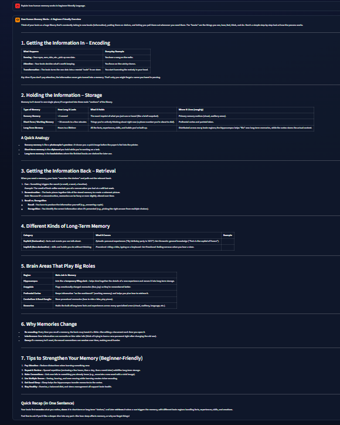
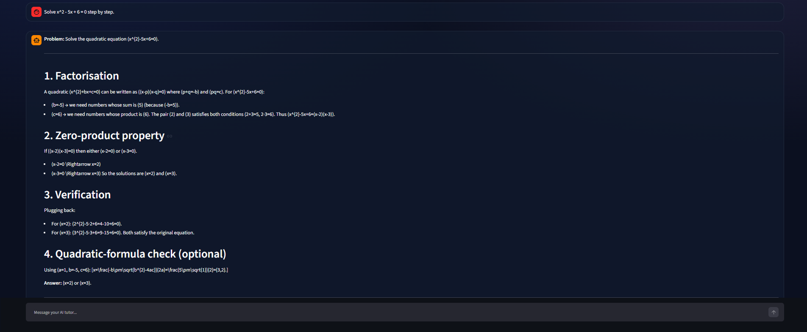
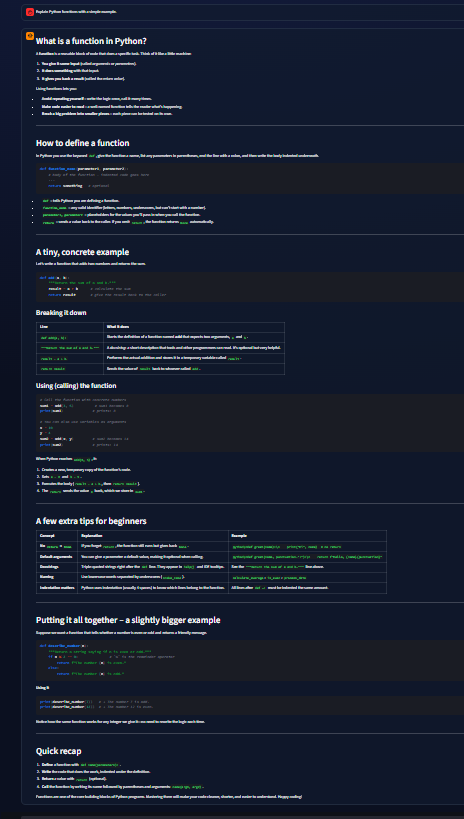
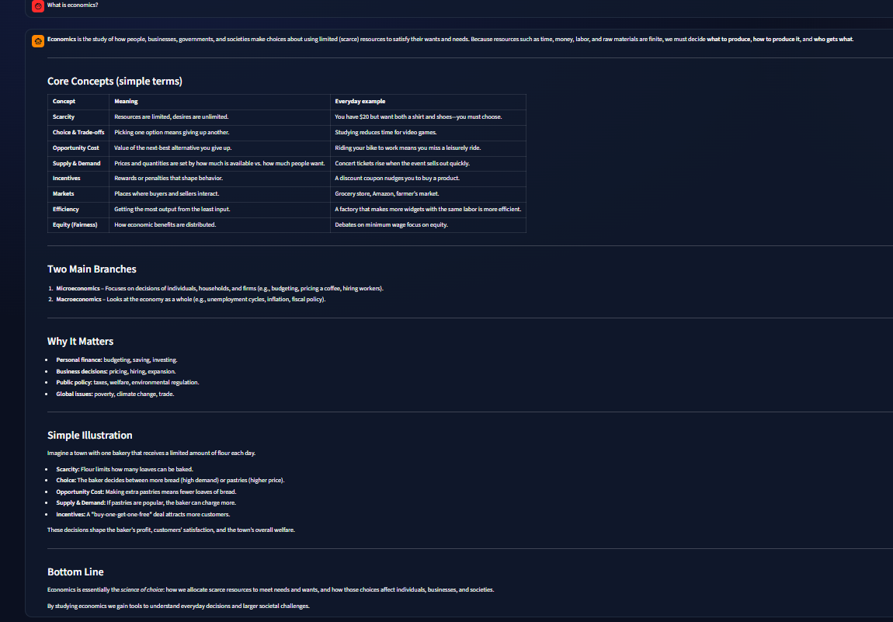
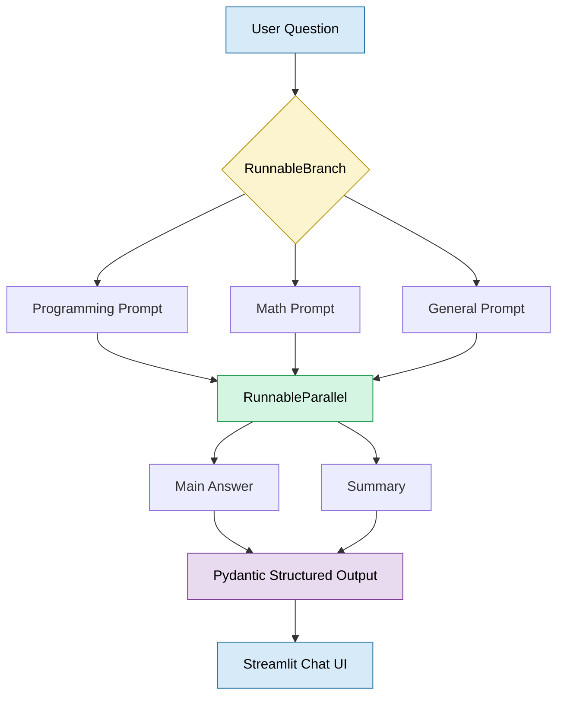

# Smart AI Tutor
### LangChain Chatbot using RunnableBranch & RunnableParallel
## 📌 Project Overview (Version 1.0)
Smart AI Tutor is a Streamlit-based AI chatbot built with LangChain and Groq. It answers programming, mathematics, and general questions while demonstrating `RunnableBranch`, `RunnableParallel`, and Pydantic structured output.

## Features

- **AI-powered responses:** Generate answers using Groq's LLM.
- **PromptTemplate:** Create reusable prompts with dynamic variables.
- **RunnableBranch:** Route questions to programming, mathematics, or general-assistant pipelines.
- **RunnableParallel:** Generate answers, summaries, and keywords concurrently.
- **Pydantic structured output:** Validate responses using `ChatGroq.with_structured_output(ChatbotResponse)`.
- **Streamlit chat interface:** Interactive chat with conversation history and a Clear Chat button.
- **Secure API-key management:** Store API credentials in a local `.env` file.

## 1. Requirements

- Python 3.10 or newer (Python 3.11 is a good choice).
- A Groq API key.
- Internet connection for model requests.

## 2. Setup

Open a terminal in this project directory.

### Windows (PowerShell)

```powershell
py -m venv .venv
.venv\\Scripts\\Activate.ps1
python -m pip install --upgrade pip
pip install -r requirements.txt
Copy-Item .env.example .env
```

If PowerShell blocks activation, you can run the venv's Python directly:

```powershell
.venv\\Scripts\\python.exe -m pip install -r requirements.txt
.venv\\Scripts\\python.exe -m streamlit run app.py
```

## 3. Add your Groq API key

1. Open `.env` in a text editor.
2. Replace  your actual Groq API key.
3. Save the file.

Example:

```dotenv
GROQ_API_KEY=api_key
GROQ_MODEL=model
```

## 4. Run the app

```bash
streamlit run app.py
```


## 5. How the code works

### `schemas.py`
Defines `ChatbotResponse`, a Pydantic model. It validates:
- `answer`: string
- `summary`: string
- `confidence`: number between 0 and 1
- `category`: one of `programming`, `mathematics`, or `general`
- `keywords`: non-empty list of strings

### `prompts.py`
Stores reusable `PromptTemplate` instances. 
### `chatbot.py`
1. Reads the API key from the environment.
2. Creates the `ChatGroq` model.
3. Uses `RunnableBranch` to select a programming, mathematics, or general chain.
4. Uses `RunnableParallel` to run answer, summary, and keyword generation concurrently.
5. Sends the combined results to a structured-output model using `with_structured_output(ChatbotResponse)`.
6. Returns a validated Pydantic object to Streamlit.


### `app.py`
Uses `st.chat_input`, `st.chat_message`, and `st.session_state` to provide a chat UI and preserve the conversation during the Streamlit session.

## Application Screenshots

### Home Page


### Home Page


### Answer Example 1


### Answer Example 2


### Answer Example 3


### User Question Example



## Example Workflow


